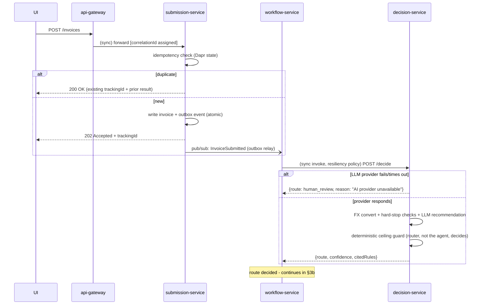
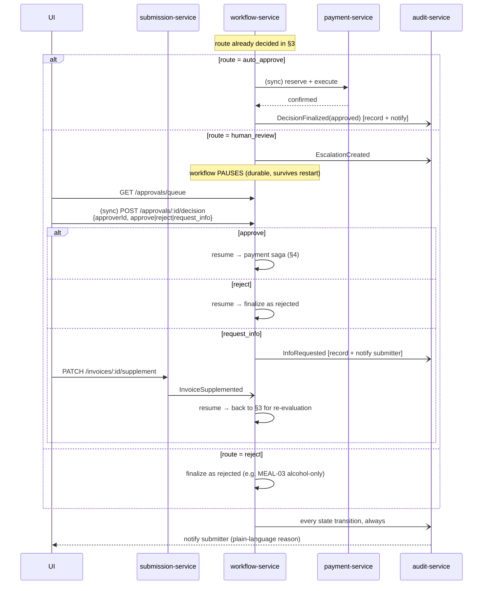
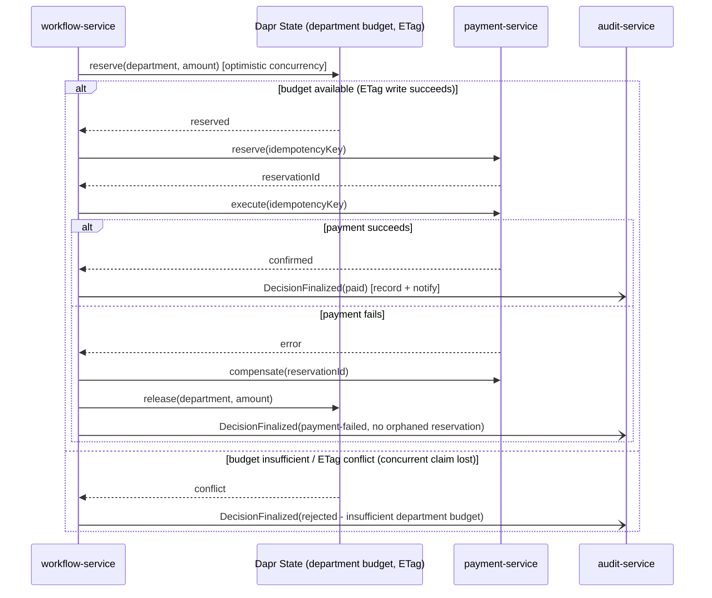

# ApprovalFlow - Architecture

This document defines the component boundaries, communication patterns, and key
technical decisions for ApprovalFlow, before implementation begins (per D1).

Stack: **Node.js/TypeScript**, **Dapr** (service invocation, pub/sub, state,
secrets, configuration, resiliency, rate-limit middleware), **Redis** (state
store + pub/sub broker for all services), **Postgres** (dedicated store for
`audit-service` - see §1a), **Gemini** as the default LLM provider
(swappable, see §6).

---

## 1. Services

| Service | Responsibility | Requirements |
|---|---|---|
| `api-gateway` | Single external entry point, rate-limiting (Dapr middleware), JWT auth + role-based authorization | M6, N1 |
| `submission-service` | Accepts submissions, returns tracking id immediately, **exposes status query**, idempotency check, outbox-based event publish | F1, F2, F3, M8, M10 |
| `decision-service` | FX conversion, deterministic hard-stop checks, LLM call via provider ACL, deterministic autonomy-ceiling guard | F4, F6, M12, M13, M15 |
| `workflow-service` | Orchestrator (Dapr Workflow): drives the full lifecycle, durable HITL pause/resume, budget reservation, payment saga, **persists agent output for the approval queue** | F4, F5, M9, M11 |
| `payment-service` | Idempotent reserve → execute → compensate against a mock payment provider | M9, M10 |
| `audit-service` | Subscribes to every domain event; records the full decision trail (**including the agent's free-text reasoning**, not just cited rule ids) in its own Postgres store, exposes ceiling-proof + dashboard queries, **and** notifies the submitter of final outcomes | F2, F8, F9, F10, M8, M14 |
| `ui` | Sign in/register, then role-gated console: submit, check status, approver queue, controller dashboard | M7, N1 |

Each service is an independent Node.js process, its own container, its own
Dapr sidecar, and (where it owns data) its own state partition - no service
reaches into another's data directly. **Every service exposes `/healthz`**
(liveness) checked both by Docker Compose `healthcheck:` and by Dapr's
built-in app-health-check feature (M15).

### 1a. Data store per service

`audit-service` uses a dedicated Postgres store (aggregation + ordered
trail queries for F8/F9); every other service uses Redis via Dapr's state
building block (simple key-value: idempotency keys, workflow state, budget
ETags). Rationale and alternatives considered: see ADR.

**Service count**: 6 backend services (M3 requires at least 3). Rationale
for this specific count, and for which services were merged/kept separate:
see ADR.

---

## 2. Dapr building blocks in use

| Building block | Used for | Requirement |
|---|---|---|
| Service invocation (sync) | `workflow-service` → `decision-service`; `workflow-service` → `payment-service`; approver actions → `workflow-service`; `audit-service` → `submission-service` (push `InvoiceRecord.status` on every event it records, closing F2's pull-status loop); `api-gateway` → `submission-service` / `workflow-service` / `audit-service` (proxies only the externally-facing routes - never `decision-service`, `payment-service`, or audit-service's internal status-push endpoint) | M5, M6 |
| Pub/Sub (async) | `submission-service` → `InvoiceSubmitted`; all services → `audit-service` (every event, incl. final outcome for notification) | M5, M8 |
| State store (Redis) | Idempotency keys, workflow instance state, department budgets (optimistic concurrency via ETags), processed-event ledger - **everywhere except `audit-service`**, which uses Postgres directly (§1a) | M5, M10 |
| Secrets | LLM provider API key, DB/broker credentials - pulled via Dapr Secrets API, never as raw env vars in code | M5 |
| Configuration | Autonomy thresholds (ceiling, confidence, FX rates) - hot-reloadable without redeploy. `policy.md` content is **not** routed through this building block: it is read from a host bind-mount instead (plain `readFileSync`, live-reload without a Dapr round-trip) - see ADR-0012 for why | M13 |
| Resiliency policies | Timeout + retry + circuit breaker on every sync invocation (`workflow-service` → `decision-service` / `payment-service`), declared in YAML, not code | M15, (N3-ready) |
| HTTP middleware (rate-limit) | `middleware.http.ratelimit` (20 req/s), wired into `api-gateway`'s sidecar only via a dedicated `Configuration` resource (`-config gateway-pipeline`) - no other sidecar references it. **Runtime behavior not yet confirmed** (needs a live container run); in-process token-bucket is the fallback if this component turns out unavailable on 1.14.4 | M6 |

---

## 3. Main sequence, part 1: submit → decide



### 3a. Status query (F2, pull - independent of the notification push)

`GET /invoices/:trackingId/status` on `submission-service`, callable at any
time. It returns the current known state (`pending` / `auto_approved` /
`awaiting_approval` / `rejected` / `paid` / `payment_failed`) plus a
plain-language reason once available. This is separate from - and does not
require - the push notification in §3b; a submitter who never checks their
email can still poll this endpoint.

---

## 3b. Main sequence, part 2: resolve (auto-approve / escalate / reject)



`Audit-->>UI` above is realized as: `audit-service` synchronously invokes `submission-service`
(`PATCH /invoices/:id/status`) on every `EscalationCreated` / `InfoRequested` / `DecisionFinalized`
it records, so `GET /invoices/:id/status` (§3a) always reflects the real, current state with a
specific reason - not just the `pending` it started as. `GET /notifications/:id` on `audit-service`
exposes the same lifecycle as a small history, for a future UI/gateway to poll instead of email/SSE
(no such channel exists in this local, free-tier project).

---

## 4. Payment flow with compensation



`payment-service` accepts an idempotency key on every call; a retried
`reserve`/`execute` with the same key returns the cached outcome instead of
re-executing (M10).

---

## 5. Idempotency strategy (M10)

| Scenario | Mechanism |
|---|---|
| Duplicate submission | `submission-service` hashes `(vendor, invoiceNumber, total)`, checked against Dapr state before accepting |
| Redelivered pub/sub event | `workflow-service` checks a processed-event-id ledger in Dapr state before acting; `audit-service` enforces the same guarantee with a unique index on its own Postgres event log (§1a) instead of Dapr state - no-op / no duplicate row if already seen |
| Retried payment call | `payment-service` keys every reserve/execute by an idempotency key (derived from correlation id + step); replays return the stored result |
| Dual-write (DB write + event publish) | Outbox pattern in `submission-service`: the state change and the outbox record are written together; a relay publishes from the outbox, so a crash between "write" and "publish" cannot happen. `payment-service` has no event of its own to publish - it only answers `workflow-service`'s synchronous calls (§4); `workflow-service` is the one that publishes to `audit-service` |

---

## 6. LLM provider abstraction (M15)

```
interface LLMProvider { complete(prompt, tools?): Promise<LLMResponse> }
```

Concrete implementations: `GeminiProvider` (default), `StubProvider` (CI/eval,
deterministic, no network call). Selected once at startup via
`LLM_PROVIDER` config - no branching in business logic. A provider error
(timeout, 5xx, malformed response) is **never** swallowed or defaulted to
approval - it forces `route = human_review` with an explicit reason,
satisfying "fail cleanly, never silently."

---

## 7. Autonomy ceiling enforcement (M12, F10)

The agent (LLM) only produces a **recommendation** + confidence + cited
`rule_id`s. A separate, deterministic function in `decision-service`
(no LLM involved) applies `policy.md §6`:

```
auto_approve  ⟺  amount ≤ AUTONOMY-CEILING
              AND confidence ≥ AUTONOMY-CONFIDENCE
              AND category policy-compliant
              AND no hard-stop present (GLOBAL-VENDOR, GLOBAL-FX, GLOBAL-MATH,
                                         GLOBAL-FRAUD, GLOBAL-RECEIPT, missing info)
```

This function is plain code, unit-testable in isolation, and is exercised by
forcing a mocked "agent recommends approve" response above the ceiling to
prove the ceiling still holds (M12's requirement).

---

## 8. Bonus-readiness: where each hook lives (not built - just located)

| Bonus | Hook location |
|---|---|
| N3 | Outbox (§5); resiliency-policy YAML (§2) |
| N4 | Correlation id propagation (§10) |
| B1 | D5 verification runner over `sample-invoices.json` |
| B2 | Agent tool functions (`fetch_policy`, `lookup_vendor`) |
| N2, B3, N6 | No hook needed (purely additive / ongoing practice) |

Rationale for why each of these is low-cost to add later: see ADR.

---

## 8a. RAG over the policy document (N5)

`decision-service/src/policy/retriever.ts` parses `policy.md` into one chunk
per `rule_id` (`parsePolicyChunks`), and `getRelevantPolicyContext(invoice)`
(`configStore.ts`) retrieves only the invoice's category section plus the
always-applicable `GLOBAL-*` rules (`selectRelevantChunks`) instead of the
whole document. An unrecognized/missing category falls back to every chunk -
retrieval never drops a rule it hasn't confidently matched. See ADR-0013.

---

## 8b. Auth & role-based authorization (N1)

`api-gateway` issues self-signed JWTs (`POST /auth/register`,
`POST /auth/login`); passwords are bcrypt-hashed and stored in the same Dapr
state store other services use. Every proxied route requires a valid bearer
token (`authenticate()`), and role-specific actions are additionally gated by
`requireRole()`:

| Role | Access |
|---|---|
| `submitter` | Submit / supplement invoices, check status |
| `approver` | Check status, work the approval queue (approve / reject / request info) |
| `admin` | Everything above, plus the audit trail, dashboard, and ceiling-proof endpoints |

The UI mirrors this at the tab level: the tab bar only renders the sections
the signed-in role is allowed to use.

Simplification (documented, not a production trust model): the role is
caller-supplied at registration - there's no external identity provider
verifying it.

---

## 9. Infrastructure (M4) and known setup risks

`docker-compose.yml` brings up, with a single `docker compose up`: the 6
application services + their Dapr sidecars, `redis`, `postgres`, the Dapr
control-plane containers (`placement`, and `scheduler` if the pinned Dapr
version requires it for Workflow - **verify during initial setup, before
building on top of Dapr Workflow**), and `ui`. All in one compose file; "one
command" does not mean "one container."

Three risks identified during review, all silent-failure-shaped (nothing
errors loudly if missed - a demo just quietly doesn't work):

- **Redis must have a persistent volume mounted.** It holds workflow
  instance state and the idempotency ledger. Without a volume, a container
  restart wipes it - and M11 ("survives a service restart") is exactly the
  scenario that would then fail during evaluation.
- **Dapr Workflow requires the Placement service** (Actors run underneath
  it) to be running in self-hosted mode; without it, workflows simply don't
  pause/resume correctly, with no obvious error pointing at the cause.
- **Dapr's native outbox-to-pubsub support is not guaranteed on a Redis
  state store** (it's best documented against SQL-backed stores) -
  **verify during setup**; if unsupported, fall back to a manual outbox: a
  small poller that reads unpublished rows from state and publishes them via
  the Dapr pubsub client. Either way, §5's guarantee (no crash between write
  and publish) must hold.

---

## 10. Cross-cutting: correlation id & structured logs (M14)

A shared `logging` package (used by every service) extracts the correlation
id from the incoming request (sync: header; async: event metadata), and
attaches it to every subsequent log line and outgoing call for that
request's lifetime. Every service propagates it forward on every Dapr
invocation and every published event - this is what lets `audit-service`
reconstruct a full decision trail (F9) by correlation id alone.

---

## 11. Requirement coverage

| Req | Covered by |
|---|---|
| F1, F3 | §3 (submission + idempotency) |
| F2 | §3a (pull status query) + §10 (push notification) |
| F4 | §3b (queue) + `workflow-service` persisting agent output (§1) |
| F5, F6 | §3b (three-way approver action); §3 (ceiling gating avoids rubber-stamping) |
| F7, M13 | §2 (Dapr Configuration) |
| F8, F9 | §1a (Postgres for aggregation + ordered trail), §10 (correlation id), §1 (agent reasoning captured, not just rule ids), §3b (`approverId` on every approval action - "who made the final call") |
| F10 | §7 |
| M3, M7 | §1 |
| M5 | §2 |
| M6 | §2 (Dapr rate-limit middleware, verify availability) |
| M8, M9 | §3, §3b, §4 |
| M10 | §5 |
| M11 | §3b (Dapr Workflow durable pause) + §9 (Redis volume risk called out) |
| M12 | §7 |
| M14 | §10 |
| M15 | §6 (provider ACL, fail-fast) + §1 (`/healthz` on every service) |
| M1, M2, M4, M16, M17, M18 | Repo/process/deployment artifacts - not architecture-diagram items, tracked separately (repo layout, CI config, README); M4's concrete infra list is in §9 |

`docs/PRODUCT-DILEMMA.md` and `docs/adr/*` (ADRs) are written separately, by
hand, per D2 - they justify *why* each decision above was made, not *what*
it is.
