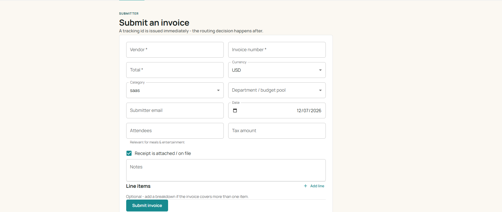
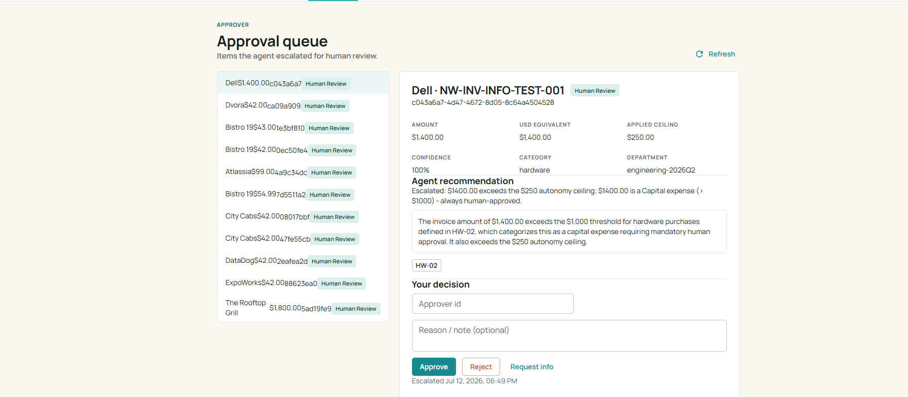
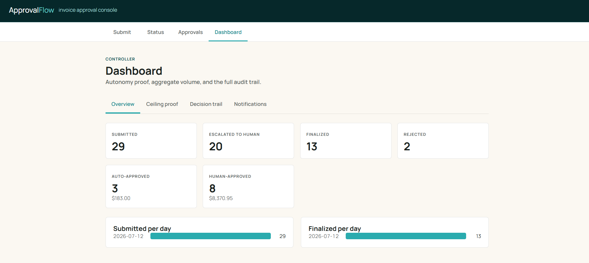
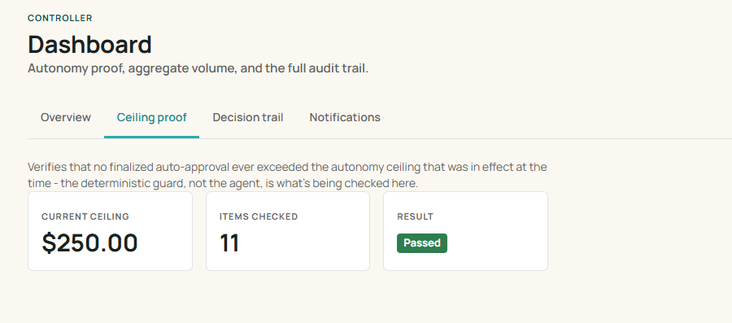

# ApprovalFlow

Invoice & Expense Approval Platform — a microservice-based, AI-assisted system
that judges invoices/expenses against a company policy, auto-approves the
low-risk majority, and escalates the rest to a human approver.

An LLM (Gemini, swappable) produces a **recommendation** only; a separate,
deterministic router applies the autonomy ceiling and hard-stop rules, so the
model never has the final say on money moving.

## Status

Implementation complete: all six services, the UI, and the shared
`packages/logging` package are built out with tests. See
[ARCHITECTURE.md](./ARCHITECTURE.md) §8 for the bonus hooks (auth, agent tool
functions) that are intentionally not built.

## Demo

🎥 Project walkthrough (screen recording): _link TBD_

📊 Project overview presentation: [`docs/media/presentation.pdf`](./docs/media/presentation.pdf)
(architecture diagrams, the autonomy-ceiling guarantee, and full requirement coverage -
renders directly on GitHub, no download needed).

## Screenshots

| Submit an invoice | Approval queue |
|---|---|
|  |  |

| Controller dashboard | Ceiling proof |
|---|---|
|  |  |

## Architecture

Full system design, service boundaries, sequence diagrams and requirement
coverage: [ARCHITECTURE.md](./ARCHITECTURE.md).

Design decisions and their rationale: [`docs/adr/`](./docs/adr) —
service boundaries, language/platform choice, saga vs. choreography,
agent-recommends/router-decides split, LLM provider abstraction, Redis vs.
Postgres per service, ETag concurrency, outbox pattern, resiliency-as-config,
bonus-hook cost, and the Dapr Workflow SDK reconnect fix.

Policy source of truth: [`policy.md`](./policy.md).
Autonomy-ceiling justification: [`docs/PRODUCT-DILEMMA.md`](./docs/PRODUCT-DILEMMA.md).

API reference: [`docs/openapi.yaml`](./docs/openapi.yaml) — an OpenAPI 3.0
spec covering every route exposed through `api-gateway`, served as an
interactive Swagger UI at `/docs` whenever the system is running (see
"Running locally" below) — no external tool needed to explore or try requests.

## Technologies

**Runtime & language**
- Node.js / TypeScript, npm workspaces (`packages/*`, `services/*`, `ui`)

**Platform (Dapr building blocks)**
- Service invocation (sync calls between services)
- Pub/Sub (domain events → `audit-service`)
- State store (idempotency keys, workflow state, budget ETags)
- Secrets (LLM key, DB credentials — never raw env vars in code)
- Configuration (hot-reloadable policy + autonomy thresholds)
- Resiliency policies (timeout, retry, circuit breaker — declared in YAML)
- HTTP rate-limit middleware (on `api-gateway`'s sidecar)

**Data stores**
- Redis — Dapr state store + pub/sub broker (all services except `audit-service`)
- Postgres — dedicated store for `audit-service` (aggregation + ordered trail)

**AI**
- Gemini — default LLM provider, behind a swappable `LLMProvider` interface
  (`GeminiProvider` / `StubProvider`), selected via `LLM_PROVIDER`

**Frontend**
- React, MUI, Vite, TypeScript

**API docs**
- OpenAPI 3.0 (`docs/openapi.yaml`), served as Swagger UI at `/docs` on `api-gateway`

**Testing & CI**
- Vitest (unit/integration, all workspaces), Testing Library, Supertest
- GitHub Actions (`.github/workflows/ci.yml`) — install, build, test on every push

**Infra**
- Docker / Docker Compose — 6 services + Dapr sidecars, Redis, Postgres,
  Dapr `placement` + `scheduler`, UI, and a dedicated mocked `tests` container

## Services

| Service | Responsibility |
|---|---|
| `api-gateway` | Single external entry point, rate-limiting, auth middleware slot, API docs at `/docs` |
| `submission-service` | Accepts submissions, tracking id + status query, idempotency, outbox event publish |
| `decision-service` | FX conversion, hard-stop checks, LLM recommendation, deterministic autonomy-ceiling guard |
| `workflow-service` | Orchestrator (Dapr Workflow): full lifecycle, durable human-review pause/resume, budget reservation, payment saga |
| `payment-service` | Idempotent reserve → execute → compensate against a mock payment provider |
| `audit-service` | Records the full decision trail (Postgres), ceiling-proof + dashboard queries, notifies submitters |
| `ui` | Submit, check status, approver queue, controller dashboard |

Each service is an independent process with its own container, its own Dapr
sidecar, and — where it owns data — its own state partition. Every service
exposes `/healthz`.

## Running locally

**Prerequisites:** [Docker Desktop](https://www.docker.com/products/docker-desktop/) installed and running.

1. Copy the example env/secrets files and fill in real values:
   ```
   cp .env.example .env
   cp secrets.json.example secrets.json
   ```
   `secrets.json` needs a real `gemini-api-key` (unless `LLM_PROVIDER` is set
   to the stub provider) and should match the Postgres password in `.env`.
2. Start everything with one command:
   ```
   docker compose up --build
   ```
   This single command brings up Redis, Postgres, the Dapr placement/scheduler
   services, all six app services with their Dapr sidecars, the UI, **and**
   runs the full test suite automatically (the `tests` container) — nothing
   else to run separately.
3. Open the app:
   - UI: http://localhost:8080
   - API gateway: http://localhost:3000
   - Interactive API docs (Swagger UI): http://localhost:3000/docs

## Testing

Tests run automatically as part of `docker compose up --build` above (the
`tests` container, fully mocked, no infra dependency).

To run tests on the host instead, without Docker:
```
npm test              # run all workspace tests (vitest)
npm run test:coverage # with coverage
```

`decision-service` also has a standalone policy-fixture check against
`sample-invoices.json`:
```
npm run verify --workspace=services/decision-service
```

## License

Private academic project — All Rights Reserved. See [LICENSE](./LICENSE).
